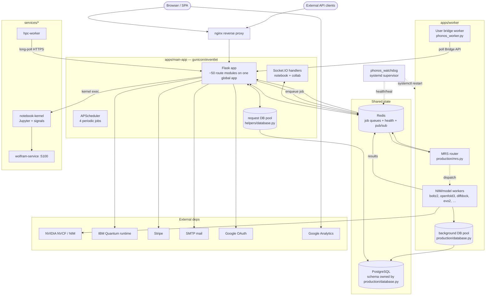
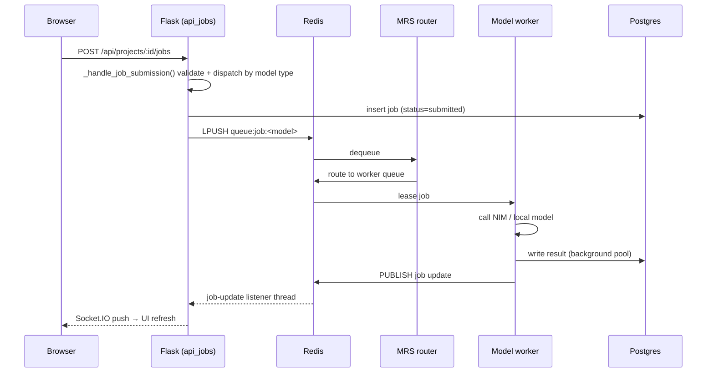
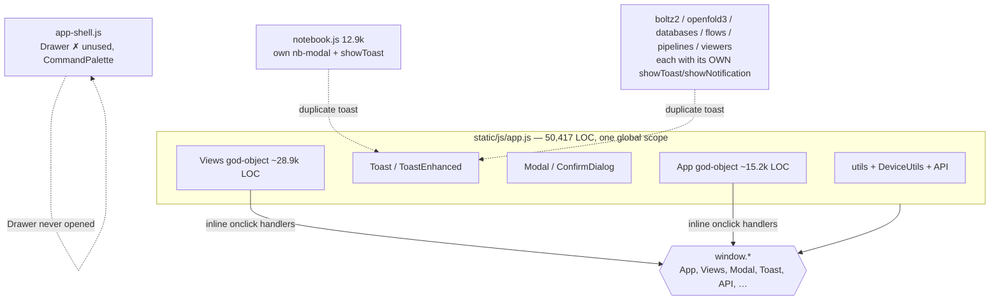

# 2. Knowledge graph

Applications, services, modules, data flows, and dependencies. Diagrams are
Mermaid (render on GitHub).

## 2.1 System topology (processes & data flows)



## 2.2 Job lifecycle (the core data flow)



Failure modes worth knowing (from `docs`/memory): jobs stick in
`submitted`/`processing` when MRS or the worker is down, or when a worker-id
auth mismatch makes results get discarded.

## 2.3 Backend module dependency (internal coupling)

```mermaid
flowchart LR
    subgraph routes[phonos_app/routes/* — ~50 modules]
        jobs[api_jobs.py 4.8k]
        nb[api_notebooks.py 3.6k]
        files[api_files.py 3.1k]
        proj[api_projects.py 2.8k]
        extv1[api_external_v1.py 2.9k]
        pub[public_api.py 2.6k ✗ disabled]
    end
    appobj{{global app object<br/>phonos_app/app.py}}
    helpers[helpers/*<br/>~85 modules]
    hdb[helpers/database.get_db]
    hsec[helpers/security]
    hmodels[helpers/models]
    prodcfg[production/config.Config<br/>SUPPORTED_MODELS ~1.8k LOC]
    proddb[production/database.py<br/>schema + bg pool 3k LOC]

    routes -->|@app.route| appobj
    routes --> hdb
    routes --> hsec
    routes --> hmodels
    hmodels --> prodcfg
    hdb --> proddb
    jobs -. view_output 1.9k .-> jobs
    jobs -. _handle_job_submission 1.6k .-> jobs
    pub -. superseded by .-> extv1
```

Coupling hotspots (call these out in review):
- **The global `app` object** — every route imports it and registers with
  `@app.route`; circular-import pressure is managed with `importlib` and
  function-level imports. This is the single biggest structural coupling.
- **`production/config.Config`** — a ~2.3k-line class dominated by a ~1.8k-line
  `SUPPORTED_MODELS` catalog that half the codebase reads.
- **Two mega-functions** in `api_jobs.py`: `view_output` (~1.9k LOC) and
  `_handle_job_submission` (~1.6k LOC).

## 2.4 Frontend module graph (the other monolith)



Key facts driving the UX refactor (doc 5):
- **8+ independent toast implementations**; the canonical `Toast` has 721 call
  sites but per-page copies (`notebook.js` `showToast`, 125 sites; viewer, boltz2,
  openfold3, custom_models, …) bypass it.
- **`Modal`** (app.js:2421) is a clean single chokepoint (44 `Modal.open` sites)
  but ~9 hand-rolled modals and the notebook `nb-modal` system bypass it, and
  **~76 native `confirm()`/`alert()`/`prompt()`** dialogs remain (app.js 14,
  notebook.js 56, others 8).
- A **generic right-side `Drawer` already exists** (`app-shell.js`,
  `window.DrawerInstance`, styled in `dashboard.css`) but has **zero call sites**
  — it is the ready-made foundation for the refactor.

## 2.5 External dependencies

| Dependency | Used by | Purpose |
|---|---|---|
| PostgreSQL | app (request pool) + workers (bg pool) | System of record; one schema, two pools |
| Redis | app + MRS + workers + watchdog | Job queues, active-jobs/health hashes, pub/sub |
| NVIDIA NVCF / NIM | model workers | Hosted inference (fold/dock/design/gen) |
| IBM Quantum runtime | quantum routes/SDK | Real quantum backends (qiskit-ibm-runtime) |
| Stripe | `stripe_routes` | Billing |
| SMTP (Flask-Mail) | app | Transactional email, invites, 2FA |
| Google OAuth | `oauth` | Social login |
| Google Analytics | frontend (consent-gated) | Product analytics |
| Wolfram Engine | `services/wolfram-service` | Wolfram Language evaluation |

## 2.6 Ownership boundaries (proposed)

| Domain | Code | Suggested owner boundary |
|---|---|---|
| Jobs & compute | `api_jobs`, `api_batches`, `api_bunches`, `api_pipelines`, workers, MRS | Compute platform |
| Notebook IDE | `api_notebooks`, `socket_handlers_notebook`, `kernel_manager`, `services/*` | Notebooks |
| Projects & collab | `api_projects`, `api_teams`, `api_messages`, `api_calls`, collab sockets | Collaboration |
| External API | `api_external_v1`, `api_project_v1`, `api_bridge` | Platform/API |
| Accounts & billing | `api_accounts`, `api_users`, `stripe_routes`, `oauth`, 2FA | Identity |
| Science domain libs | `sequence_utils`, `structure_analysis`, `models` | Bio/Chem |
